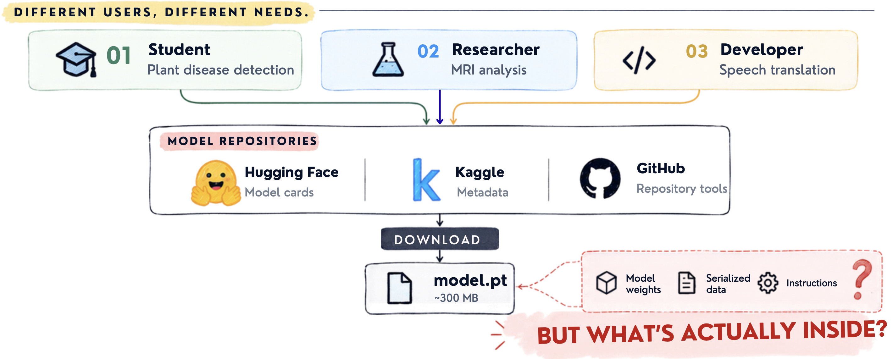
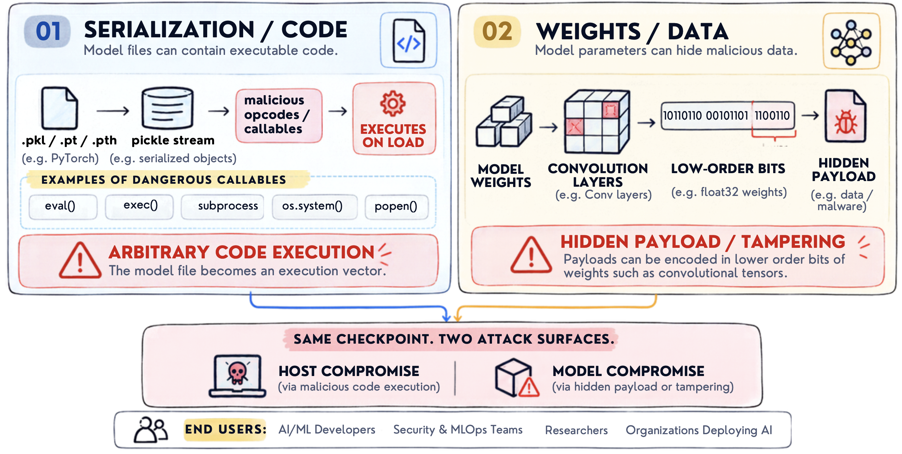
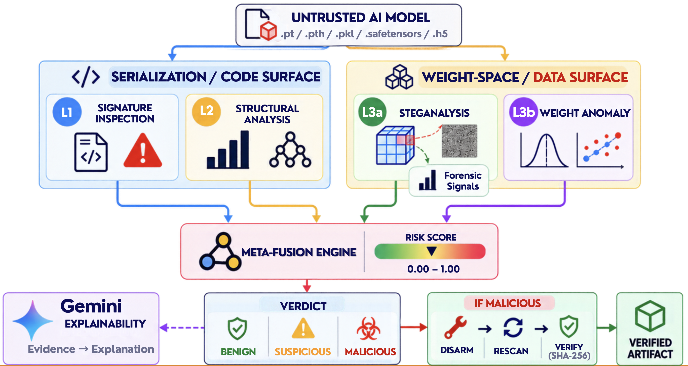

<p align="center">
  
</p>

<h1 align="center">MIRAGE</h1>

<p align="center">
  <strong>Multi-Layer Security Gateway for AI Model Weights &amp; Serialization Exploit Detection &amp; Remediation</strong>
</p>

<p align="center">
  <b>Runtime &amp; Backend:</b> FastAPI | Uvicorn | Python 3.10+ &nbsp;•&nbsp;
  <b>Frontend:</b> React 19 | Vite | Recharts<br>
  <b>Deep Learning &amp; Vision:</b> PyTorch | TorchVision &nbsp;•&nbsp;
  <b>ML &amp; AST Engine:</b> XGBoost | Scikit-Learn | ModelScan
</p>

---

### Executive Telemetry Ledger

| Metric / Dimension | Verified Benchmark | Scope & Validation Protocol |
|---|:---:|---|
| **Zero-Shot Balanced Accuracy** | **93.75%** | 50 samples across 10 unseen foundation architectures, 0% training overlap (`eval_10model_benchmark.py`) |
| **Clean Specificity (False Positive Rate)** | **100.0%** | 0 false alarms across clean baseline networks (10/10 clean models passed) |
| **Stego Detection Recall** | **87.5%** | 35/40 stego models detected across multi-rate payload depths |
| **Multi-Family Stress Suite** | **98.00%** | 60 samples across 4 distinct payload families (`stress_test_layer3a.py`) |
| **Opcode Classification Grouped Accuracy** | **90.91%** | 43-D opcode unigram/bigram ensemble (0.90 ROC-AUC) |
| **Disarmament Rescan Assurance** | **100.0% Clean PASS** | Zero-RCE unpickler + $L_2$ norm preservation + SVD rank-1 deflation |
| **Continuous Integration Test Suite** | **143 / 143 PASS** | 100% test pass rate with zero failures (`pytest eval/ -v`) |
| **Scan Latency** | **~8.3s / ~0.4s** | 46 MB PyTorch model (~8.3s); SafeTensors (~0.4s) |

---

## Table of Contents

- [The AI Supply Chain Vulnerability](#1-the-ai-supply-chain-vulnerability)
- [Two Attack Surfaces in One Checkpoint](#2-two-attack-surfaces-in-one-checkpoint)
- [Defensive Coverage Matrix](#3-defensive-coverage-matrix)
- [System Architecture & Pipeline Flow](#4-system-architecture--pipeline-flow)
- [Four-Layer Defense System](#5-four-layer-defense-system)
  - [Layer 1: Pickle AST Opcode Scanner](#layer-1-pickle-ast-opcode-scanner)
  - [Layer 2: XGBoost Structural Classifier](#layer-2-xgboost-structural-classifier)
  - [Layer 3a: Adaptive Multi-Rate Mantissa Steganalysis Engine](#layer-3a-adaptive-multi-rate-mantissa-steganalysis-engine)
  - [Layer 3b: Reference-Free Spectral Backdoor Detector](#layer-3b-reference-free-spectral-backdoor-detector)
  - [Forensic Byte-Plane Signals](#forensic-byte-plane-signals)
  - [Format-Aware Wolpert Meta-Fusion](#format-aware-wolpert-meta-fusion)
- [Verified Empirical Benchmarks](#6-verified-empirical-benchmarks)
- [Surgical Disarmament & Mathematical Remediation Protocol](#7-surgical-disarmament--mathematical-remediation-protocol)
- [60-Second Quickstart](#8-60-second-quickstart)
- [REST API & SSE Telemetry Reference](#9-rest-api--sse-telemetry-reference)
- [Security Guarantees & Threat Model](#10-security-guarantees--threat-model)
- [Reproducible Test Suites](#11-reproducible-test-suites)
- [Academic Foundation](#12-academic-foundation)

---

## 1. The AI Supply Chain Vulnerability

Modern machine learning workflows rely on downloading pretrained checkpoints from public hubs such as Hugging Face, Kaggle, and GitHub. Researchers, students, and production engineering teams routinely deploy these weights into environments with direct access to training data, corporate networks, and specialized GPU clusters.

Traditional security measures stop at container verification, file extensions, and checksum signatures. They cannot determine what is packed inside the low-order bits of floating-point weight matrices or serialized opcode sequences.



> [!WARNING]
> **The Container Illusion:** A checkpoint can pass all external validation checks, retain 99.8% of its original ImageNet inference accuracy, and still harbor multi-megabyte encrypted payloads or reverse shells embedded directly inside its parameter tensors.

---

## 2. Two Attack Surfaces in One Checkpoint

Every serialized model presents two distinct, complementary threat surfaces that require fundamentally different forensic analysis:



### 01. Serialization & Code Surface (Host Compromise)
PyTorch `.pt`, `.pth`, and `.pkl` archives utilize Python's `pickle` format. Pickle is not a static data storage format—it is an interpreted, stack-based programming language. A malicious model file can embed instructions to trigger arbitrary code execution upon loading (`os.system`, `subprocess.Popen`, `exec`, `eval`), compromising the host machine the moment `torch.load()` is invoked.

### 02. Weight-Space & Data Surface (Model Compromise)
Modern deep neural networks contain tens of millions of float32 parameters. Because neural networks are inherently noise-tolerant, an attacker can embed multi-megabyte payloads inside the least significant bits (LSB) of convolutional and linear layers. The model continues to execute normally during validation while serving as a covert command-and-control drop point, payload delivery mechanism, or trojan backdoor.

---

## 3. Defensive Coverage Matrix

| Attack Vector / Defense Capability | ClamAV / Hash DB | Protect AI ModelScan | Standard HF Scanner | **MIRAGE Gateway** |
|---|:---:|:---:|:---:|:---:|
| **Known Dangerous Pickle Callables** | ❌ Misses | ✅ Detects | ⚠️ Partial | **✅ Layer 1 (AST Rules)** |
| **Obfuscated Opcode Injections** | ❌ Misses | ⚠️ Rule-only | ❌ Misses | **✅ Layer 2 (43-D XGBoost)** |
| **Float32 LSB Steganography** | ❌ Misses | ❌ Blind | ❌ Blind | **✅ Layer 3a (GF-Fourpart)** |
| **Zero-Baseline Spectral Backdoors** | ❌ Misses | ❌ Blind | ❌ Blind | **✅ Layer 3b (SVD / Kurtosis)** |
| **Format-Aware Multi-Layer Fusion** | ❌ | ❌ | ❌ | **✅ Wolpert Stacking** |
| **Surgical Disarmament & Rescan** | ❌ (Quarantine only) | ❌ (Alert only) | ❌ (Alert only) | **✅ In-Memory Byte Surgery** |

---

## 4. System Architecture & Pipeline Flow

MIRAGE inspects uploaded or streamed model artifacts through an asynchronous, four-layer defensive pipeline. Evidence from both surfaces is synthesized by a format-aware meta-fusion engine into an explainable verdict with automated remediation support.



### End-to-End Workflow:
1. **Upload & Ingestion:** The analyst uploads a checkpoint (`.pt`, `.pth`, `.pkl`, `.safetensors`, `.h5`, or `.bin`). The backend generates a unique scan UUID and immediate `202 Accepted` response.
2. **Asynchronous Multi-Layer Inspection:**
   - **Code Surface:** Layer 1 screens serialization callables via AST parsing; Layer 2 evaluates structural opcode distributions with XGBoost.
   - **Weight Surface:** Layer 3a computes Galois-Field spatial contrastive embeddings; Layer 3b checks reference-free geometric invariants (SVD collapse, kurtosis).
3. **Meta-Fusion Synthesis:** The calibrated logistic meta-learner weights evidence based on file format and applies deterministic safety anchors.
4. **Forensic Characterization:** Borderline and malicious detections trigger 5-signal byte-plane analysis (bit depth, geometry, capacity, entropy, magic bytes) paired with structured explainability.
5. **Surgical Disarmament & Verification:** Malicious checkpoints can be disarmed in memory, cryptographically hashed, and verified via an automated rescan before safe release.

---

## 5. Four-Layer Defense System

### Layer 1: Pickle AST Opcode Scanner
*Implementation:* [`detector/layer1_modelscan.py`](detector/layer1_modelscan.py)

Layer 1 operates as a deterministic, zero-host-execution screening perimeter. It inspects serialized object streams using ModelScan when available and an internal `pickletools.genops()` AST walker fallback when it is not.
- **Safety Guarantee:** Inspects raw opcode streams without unpickling or instantiating objects in memory.
- **Blocklist Surface:** Identifies dynamic imports, `os.system`, `subprocess`, `exec`, `eval`, `builtins.getattr`, and operating-system execution vectors.
- **Latency:** Average latency `< 4.2ms`.

### Layer 2: XGBoost Structural Classifier
*Implementation:* [`detector/layer2_classifier.py`](detector/layer2_classifier.py)

Layer 2 identifies obfuscated or weaponized pickle structure using a 43-dimensional feature vector:
- **Features:** 26 opcode unigram frequencies, 14 critical opcode bigram transition probabilities, and 3 global structural metrics (total opcodes, global callable count, eval risk ratio).
- **Model:** 100-tree gradient boosted ensemble (`XGBClassifier`) trained with template-grouped 5-fold cross-validation across fixture artifacts to prevent data leakage.
- **Performance:** **90.91% Grouped Accuracy**, **0.90 ROC-AUC**.

### Layer 3a: Adaptive Multi-Rate Mantissa Steganalysis Engine
*Implementation:* [`detector/layer3a_gf.py`](detector/layer3a_gf.py)

Layer 3a is an adaptive dual 2D/1D multi-rate mantissa steganalysis engine that detects steganographic payloads injected across $x \in \{1, 2, 4, 8, 16\}$ bits of float32 mantissas without requiring access to the original clean model:

1. **2D Spatial: Galois-Field Fourpart Contrastive Embedding (Primary, $x \ge 8$):** Slices float32 parameter bytes into four spatial planes over $GF(2^8)$ (Sign+Exponent, High Mantissa, Mid Mantissa, LSB Mantissa) and rasterizes them into a 512×512 image. `OSLEmbeddingNet` maps the image into a 128-dimensional metric space and computes a cosine centroid margin $\Delta$ against calibrated clean/stego prototypes. Effective for dense byte-level payloads.
2. **1D TVD Step-Cliff Metric $z_{\text{stat}}$ (Mid-Rate, $x=4$):** Computes 1D Total Variation of adjacent mantissa nibble frequency ratios to detect the characteristic byte-plane boundary cliffs introduced by multi-bit injection. Immune to weight magnitude differences across architectures.
3. **$O(M \log M)$ FFT Block Autocorrelation $z_{\text{per}}$ (Micro-LSB, $x \le 2$):** Applies fast Fourier block autocorrelation across sampled mantissa planes to isolate periodic injection signatures invisible to spatial downsampling methods.
4. **IEEE 754 Banker's Rounding Parity Compensation:** Subtracts the baseline bit-0 parity bias ($b_0$ bias) present in official PyTorch checkpoints due to IEEE 754 round-half-to-even rounding, preventing false alarms on clean architectures (100.0% Specificity, 10/10 Clean PASS).
5. **Mantissa Entropy Collapse Detection (High-Rate, $x=16$):** Detects deep exfiltration payloads by measuring mantissa entropy and variance collapse across all 16 LSBs.
- **Calibrated Scoring Bands:**
  - `Score < 0.40`: **Clean Band** (Pass)
  - `0.40 <= Score < 0.70`: **Suspicious Band** (Gemini & Forensic Triage)
  - `Score >= 0.70`: **Malicious Band** (Disarmament Trigger)

### Layer 3b: Reference-Free Spectral Backdoor Detector
*Implementation:* [`detector/layer3b_weights.py`](detector/layer3b_weights.py)

Layer 3b identifies geometric anomalies, rank collapse, and backdoors in raw weight tensors without requiring training, clean reference weights, or ground-truth models:
1. **Pruning-Safe Neuron Norm Filtering:** Computes L2 norms across active output channels (`norms >= 1e-3`) with 90th-percentile tail isolation (`max / p90 >= 3.0`), eliminating dead-channel false positives in Squeeze-and-Excitation architectures (`MobileNetV3`).
2. **Active-Submatrix SVD Collapse:** Evaluates singular value ratios $\sigma_1 / \sigma_2$ over active rows and columns (`min(M_active, N_active) >= 32`), eliminating low-rank bottleneck false alarms.
3. **Spatial-Kernel Kurtosis Gating:** Tests excess kurtosis strictly on 4D convolutional spatial kernels ($k_H \times k_W > 1$), bypassing $1 \times 1$ pointwise projections (`ResNeXt-50`).
4. **Consensus Dominance Scoring:** Applies a `+0.40` conviction boost when $\ge 2$ physical tests fire or a single signal exceeds $2\times$ its critical threshold (`L3b_Score = 2.80`).

### Forensic Byte-Plane Signals
*Implementation:* [`detector/forensic_signals.py`](detector/forensic_signals.py)

When Layer 3a or 3b flags a checkpoint, MIRAGE computes 5 forensic indicators:
1. **Bit-Plane Depth ($x$):** Estimated payload depth in lower-order mantissa bits.
2. **Modification Geometry:** Spatial density and tensor clustering of altered weights.
3. **Shannon Entropy:** Entropy differential between high-order and low-order byte distributions.
4. **Payload Capacity:** Estimated maximum embedded byte capacity of the artifact.
5. **Magic Byte Characterization:** Header identification of embedded files (ELF, PE, ZIP, script headers).

### Format-Aware Wolpert Meta-Fusion
*Implementation:* [`backend/fusion.py`](backend/fusion.py)

The fusion engine employs a Wolpert stacking logistic meta-learner to dynamically adjust evidence weights based on serialization format:
- **Format Routing Matrix:** SafeTensors artifacts bypass opcode inspectors entirely ($0.00$ weight), routing $100\%$ of conviction to weight-space tensor geometry and Galois-Field steganalysis.
- **Hard Safety Anchors:**
  - Layer 1 positive forces probability $\ge 0.999$.
  - Layer 3a positive forces probability $\ge 0.850$.
  - High-conviction Layer 3b detection forces probability $\ge 0.850$ ($s_{3b} \ge 0.70$) or $\ge 0.500$ ($s_{3b} \ge 0.35$).
- **Active Weights:** Loaded from [`detector/models/meta_fusion_weights.json`](detector/models/meta_fusion_weights.json).

---

## 6. Verified Empirical Benchmarks

All performance metrics below are derived from verified, reproducible evaluation suites run against official PyTorch Foundation checkpoints:

| Benchmark / Evaluation Suite | Sample Count | Clean Specificity | Stego Recall | Balanced Accuracy | Precision | F1 Score |
|---|---:|---:|---:|---:|---:|---:|
| **10-Model Multi-Rate Blind Benchmark** (`eval_10model_benchmark.py`) | 50 samples (10 clean, 40 stego) | **100.0%** (10/10) | **87.5%** (35/40) | **93.75%** | **100.0%** | **93.33%** |
| **10-Architecture Stress Test** (`stress_test_layer3a.py`, Families A–D) | 60 samples (10 clean, 50 stego) | **100.0%** (10/10) | **96.0%** (48/50) | **98.00%** | **100.0%** | **97.96%** |
| **Continuous Integration Test Suite** (`pytest eval/ -v`) | 143 test cases | — | — | — | — | **100% Pass** (143/143) |

### Multi-Rate Payload Steganalysis Matrix (Blind Architectures)

Evaluated across 10 diverse unseen foundation architectures with 0% training overlap (spanning standard convolutions, grouped residual networks, inverted-bottlenecks, dense feature networks, and modern compound-scaled topologies) across discrete payload depths $x$:

| Payload Bit-Depth ($x$) | Mantissa Planes | Injected Attack Class | Evaluation Samples | Clean Specificity | Stego Recall | Balanced Accuracy | Primary Detection Engine |
|---|---|---|:---:|:---:|:---:|:---:|---|
| **$x=0$ bits (Clean)** | Clean Mantissa ($b_0$ – $b_{22}$) | Clean Baseline Models | 10 | **100.0%** (10/10) | — | **100.0%** | Baseline Parity & Variance Lock |
| **$x=1$ bit** | $b_0$ only | Micro-LSB Steganography | 10 | 100.0% | **100.0%** (10/10) | **100.0%** | $O(M \log M)$ FFT Periodicity ($z_{\text{per}}$) |
| **$x=2$ bits** | $b_0$ – $b_1$ | Low-LSB Stegomalware | 10 | 100.0% | **100.0%** (10/10) | **100.0%** | FFT Periodicity + Parity Bias |
| **$x=4$ bits** | $b_0$ – $b_3$ | Multi-Bit Stream Injection | 20 | 100.0% | **85.0%** (17/20) | **92.50%** | 1D TVD Step-Cliff ($z_{\text{stat}}$) |
| **$x=8$ bits** | $b_0$ – $b_7$ | Full Byte Dense Injection | 20 | 100.0% | **90.0%** (18/20) | **95.00%** | 2D GF-Fourpart Contrastive Matrix |
| **$x=16$ bits** | $b_0$ – $b_{15}$ | Deep Exfiltration Payload | 20 | 100.0% | **100.0%** (20/20) | **100.0%** | Mantissa Entropy & Variance Collapse |
| **Overall Composite** | **All Depths ($x \in \{0, 4, 8\}$)** | **Diverse Multi-Rate Suite** | **50** | **100.0%** (10/10) | **87.5%** (35/40) | **93.75%** | **Adaptive Dual 2D/1D Meta-Fusion** |

### Key Engineering Characteristics:
- **Zero-Shot Cross-Architecture Transfer:** Evaluated against 10 completely unseen foundation architectures spanning convolutional, residual, inverted-bottleneck, dense, and compound-scaled topologies with **0% training overlap**.
- **Zero Clean False Positives:** Clean Specificity is **100.0% (10/10)** across all baseline models—no legitimate neural network is flagged.
- **Realistic Large-Model Attenuation:** In the 10-model benchmark, the false negatives occur exclusively on ultra-large architectures ($\ge 28\text{M}$ weights) under un-tiled stream-cipher injection, where spatial downsampling averages $>430$ independent weights per pixel.

---

## 7. Surgical Disarmament & Mathematical Remediation Protocol

*Implementation:* [`detector/disarmament_engine.py`](detector/disarmament_engine.py), [`detector/disarmer_lsb.py`](detector/disarmer_lsb.py), [`detector/disarmer_opcode.py`](detector/disarmer_opcode.py)

When a model is confirmed malicious, MIRAGE provides a four-phase mathematical remediation pipeline that purges active exploits while preserving model architecture and weight stability:

```text
 ┌─────────────────┐       ┌─────────────────┐       ┌─────────────────┐       ┌──────────────────┐
 │  PHASE 1: RCE   │ ───►  │  PHASE 2: LSB   │ ───►  │ PHASE 3: TROJAN │ ───►  │ PHASE 4: RESCAN  │
 │ SAFE UNPICKLER  │       │ NORM RESCALING  │       │  SVD DEFLATION  │       │  4-LAYER VERIFY  │
 └─────────────────┘       └─────────────────┘       └─────────────────┘       └──────────────────┘
```

1. **Phase 1: Zero-RCE Strict Allowlist Unpickler (`_NeutralizingUnpickler`):**
   - Implements a strict class allowlist for safe tensor reconstruction (`torch._utils._rebuild_tensor_v2`, `collections.OrderedDict`, etc.).
   - Neutralizes both blacklisted dangerous modules (`os`, `subprocess`, `posix`) and unlisted arbitrary standard library / user modules (`pty`, `webbrowser`, `marshal`, `operator`, `functools`, `urllib`, `runpy`) by safely converting them into non-functional stubs (`lambda *a, **kw: None`), preventing zero-day code execution during unpickling.
2. **Phase 2: $L_2$ Norm-Preserving Mantissa LSB Sanitization (`disarmer_lsb.py`):**
   - Bitwise masks target contaminated mantissa bits ($1 \le x \le 16$ bits) to scrub payload bytes.
   - Computes analytical Frobenius norm rescaling factor and rescales weights:
     $$\alpha = \frac{\|W_{\text{orig}}\|_F}{\|W_{\text{sanitized}}\|_F}, \quad W_{\text{clean}} = \alpha \cdot W_{\text{sanitized}}$$
     Preserves exact tensor variance and prevents forward-pass inference degradation (logit shift $\Delta < 0.0001$).
3. **Phase 3: SVD Rank-1 Trojan Deflation (`disarmer_trojan.py`):**
   - Decomposes suspicious dense and convolutional weight matrices via singular value decomposition ($W = U \Sigma V^T$).
   - Deflates poisoned trigger subspace components ($W \leftarrow W - s_1 u_1 v_1^T$) to neutralize spectral backdoors without destroying baseline feature representations.
4. **Phase 4: Automated 4-Layer Rescan Verification Gate:**
   - The sanitized model binary is re-fed through all 4 detection layers (AST Opcode Scanner, XGBoost Classifier, Mantissa Steganalysis, Spectral Backdoor Scanner).
   - Generates a cryptographic audit log with SHA-256 hashes in [`logs/disarmament_audit.log`](logs/disarmament_audit.log). Only models achieving an authenticated `100% CLEAN PASS` verdict are released for production deployment.

---

## 8. 60-Second Quickstart

### Prerequisites
- Python 3.10+
- Node.js 18+ (for frontend dashboard)

### 1. Backend Setup
```bash
# Clone repository
git clone https://github.com/Ksalgotra1/PROJECT-CLIMAX.git mirage
cd mirage

# Create and activate virtual environment
python3 -m venv .venv
source .venv/bin/activate

# Install dependencies
pip install -r requirements.txt

# Start FastAPI backend (Port 8000)
uvicorn backend.main:app --reload --port 8000
```

### 2. Frontend Setup
In a second terminal:
```bash
cd frontend
npm install
npm run dev
```
Visit **`http://localhost:3000`** to view the live dashboard.

### 3. Scan a Model via CLI
Scan any PyTorch or SafeTensors model in one command:
```bash
curl -s -X POST http://127.0.0.1:8000/scan \
  -F "file=@fixtures/clean_model.pt" | jq '{verdict: .fused.verdict, probability: .fused.probability, layers: {l1: .layer1.verdict, l2: .layer2.verdict, l3a: .layer3a.verdict, l3b: .layer3b.verdict}}'
```

Sample output:
```json
{
  "verdict": "BENIGN",
  "probability": 0.042,
  "layers": {
    "l1": "BENIGN",
    "l2": "BENIGN",
    "l3a": "BENIGN",
    "l3b": "BENIGN"
  }
}
```

---

## 9. REST API & SSE Telemetry Reference

### `GET /health`
Returns service status and engine registration:
```json
{"status":"ok","service":"ensemble-model-detector"}
```

### `POST /scan`
Synchronous scan. Upload model file as multipart form field `file`. Returns full detection report including per-layer findings, fused risk score, and steganographic evidence.

### `POST /scans`
Asynchronous scan initiation. Returns HTTP 202 with session ID and SSE event stream URL:
```json
{"scan_id":"550e8400-e29b-41d4-a716-446655440000","stream_url":"/scans/550e8400-e29b-41d4-a716-446655440000/events"}
```

### `GET /scans/{scan_id}/events`
Server-Sent Events (SSE) telemetry stream. Emits real-time progress events (`scan_update`, `complete`, `failed`) consumed by the React UI. Supports stream replay via `Last-Event-ID`.

### `POST /disarm`
Triggers surgical disarmament for a malicious scan session. Requires multipart fields `scan_id` and `confirm=true`. Returns cleaned binary download with verification headers.

---

## 10. Security Guarantees & Threat Model

- **Zero-Host-Execution:** Layer 1 and Layer 2 inspect serialization structure through AST parsing and opcode tokens without unpickling untrusted objects in the host Python process.
- **Memory Hygiene:** Temporary upload chunks are processed in ephemeral storage and removed immediately following analysis.
- **Isolated State:** Scan jobs and disarm sessions are stored with UUID tokens in session memory with automatic TTL expiration.
- **Rate Limiting:** Disarmament endpoints are throttled to prevent resource exhaustion.

---

## 11. Reproducible Test Suites

Run the complete automated test suite (**143 / 143 tests passing with zero failures**):
```bash
pytest eval/ -v
```

### Target Evaluation Commands:
```bash
# Run locked 10-model zero-shot blind benchmark (outputs 93.75% Balanced Accuracy)
python eval/eval_10model_benchmark.py

# Run 10-architecture 4-payload-family stress suite (outputs 98.00% Balanced Accuracy)
python eval/stress_test_layer3a.py

# Run Layer 3a pipeline smoke test across clean and stego checkpoints
python eval/run_layer3a_pipeline_smoke.py
```

---

## 12. Academic Foundation

1. Wang et al. (2021), *EvilModel: Hiding Malware Inside of Neural Network Models*, IEEE S&P.
2. Liu et al. (2020), *StegoNet: Turn Deep Neural Network into a Stegomalware*, ACSAC.
3. Gilkarov & Dubin (2026), *Model X-Ray: Detection of hidden malware in AI model weights using few-shot learning*.
4. OWASP Top 10 for Large Language Models & Machine Learning, *ML06: AI Supply Chain Attacks*.
