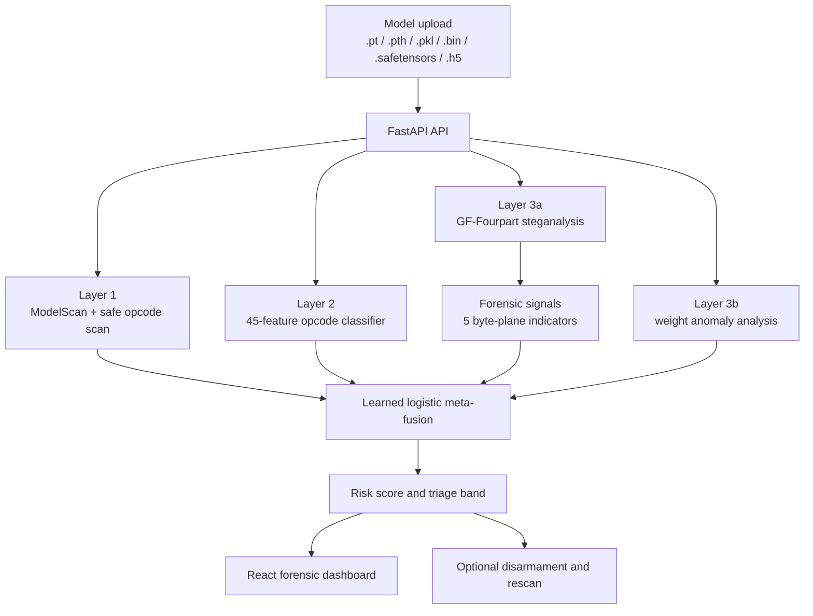
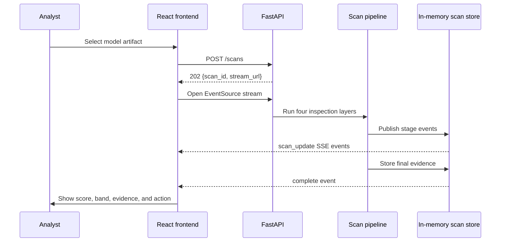
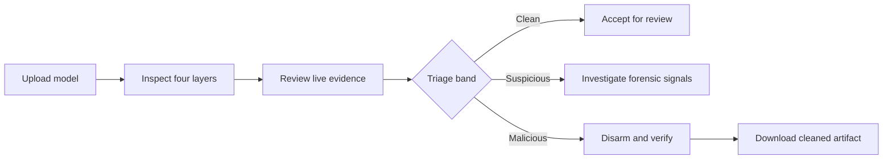

# MIRAGE

**Built with** FastAPI | React 19 | Vite | PyTorch | TorchVision | XGBoost | ModelScan

**A multi-layer security scanner for detecting serialization exploits and steganographic malware hidden inside AI model weights.**

MIRAGE inspects downloaded or uploaded model artifacts through four complementary detection layers. It combines dangerous-callable scanning, opcode-structure classification, GF-Fourpart weight steganalysis, and reference-free tensor analysis into one forensic workflow with live progress, explainable evidence, format-aware fusion, and disarmament support.

## Live Demo

| | URL |
|---|---|
| **Frontend** | `[Add deployment URL]` |
| **Backend API** | `[Add deployment URL]/health` |
| **Video** | `[Add video link]` |

## Table of Contents

| Section | Subsections |
|---|---|
| **Overview** | — |
| **Demo** | — |
| **Tech Stack** | Dependencies and runtime |
| **System Architecture** | Request flow, detector pipeline, fusion |
| **User Workflow** | Scan, investigate, disarm |
| **Detection Layers** | Layer 1, Layer 2, Layer 3a, Layer 3b |
| **Engineering Highlights** | SSE, forensic signals, meta-fusion |
| **Folder Structure** | Backend, detector, frontend, evaluation |
| **Installation** | Backend, frontend, optional Gemini |
| **API Reference** | Health, scan, SSE, disarm, fixtures |
| **Security** | Upload handling, opcode safety, remediation |
| **Evaluation** | Benchmarks and reported results |
| **Future Work** | Deployment and research improvements |
| **Tests** | Commands and coverage areas |

## Overview

AI models are increasingly downloaded from public repositories and third-party sources. Traditional defenses inspect the file container, serialization format, checksum, or signature, but a model can remain behaviorally accurate while carrying a payload in the low-order bits of its floating-point weights.

MIRAGE analyzes both attack surfaces:

- **Serialization threats:** dangerous pickle callables and obfuscated opcode structure.
- **Weight threats:** steganographic payloads and abnormal tensor distributions.

The result is an evidence-preserving scan rather than a single opaque Boolean. Analysts receive per-layer findings, calibrated risk, forensic characterization, recommended triage, and optional cleanup of a malicious artifact.

## Demo

The dashboard provides:

- live model upload and scan telemetry;
- per-layer evidence and fusion output;
- benchmark charts and a local scan ledger;
- an interactive four-layer field manual;
- a disarmament workflow for malicious scan sessions.

## Tech Stack

| Layer | Technology |
|---|---|
| **Backend** | Python, FastAPI, Uvicorn |
| **Detection** | PyTorch, TorchVision, ModelScan, XGBoost, scikit-learn |
| **Weight formats** | PyTorch/pickle, SafeTensors, HDF5, `.bin` |
| **Frontend** | React 19, Vite, React Router, Recharts |
| **Streaming** | Server-Sent Events via `EventSource` |
| **Optional AI** | Gemini summaries through `GEMINI_API_KEY` |
| **Testing** | Pytest and Python `unittest` |
| **Artifacts** | Detector models, calibration bundles, fixtures, charts |

## System Architecture



### High-Level Request Flow



## User Workflow



1. Upload a model with a supported extension.
2. The frontend starts an asynchronous scan and subscribes to the event stream.
3. The backend runs each detector sequentially and reports stage metadata.
4. Fusion maps the evidence to `BENIGN`, `SUSPICIOUS`, or `MALICIOUS`.
5. Suspicious and malicious weight findings receive deeper forensic analysis.
6. A malicious session can be submitted to the disarmament endpoint for cleanup and verification.

## Detection Layers

### Layer 1: Pickle AST Opcode Scanner

Implementation: [detector/layer1_modelscan.py](detector/layer1_modelscan.py)

Layer 1 uses ModelScan when available and a safe `pickletools.genops()` fallback when it is not. It reads pickle members from PyTorch archives or direct pickle streams without executing the serialized object. Dangerous references include `eval`, `exec`, subprocess operations, operating-system commands, dynamic imports, and platform-specific `system` or `popen` targets.

### Layer 2: XGBoost Structural Classifier

Implementation: [detector/layer2_classifier.py](detector/layer2_classifier.py)

Layer 2 profiles pickle structure with 45 features: 28 opcode unigrams, 14 opcode bigrams, and 3 structural metrics. The packaged XGBoost model is used when available; otherwise, a deterministic structural-risk fallback provides a score. The layer is applied to `.pkl`, `.pt`, and `.pth` paths.

### Layer 3a: GF-Fourpart Cross-Architecture Steganalysis

Implementation: [detector/layer3a_gf.py](detector/layer3a_gf.py)

Layer 3a converts float32 parameter bytes into a four-quadrant GF-Fourpart image and embeds the result with `OSLEmbeddingNet`. Clean and stego prototypes are compared in a 128-dimensional embedding space. The calibrated score is assigned to three bands:

| Score | Band |
|---:|---|
| `< 0.40` | Clean |
| `0.40–<0.70` | Suspicious |
| `>= 0.70` | Malicious |

Supported paths include PyTorch, pickle, SafeTensors, HDF5, and `.bin` artifacts when float32 tensors are available.

### Layer 3b: Statistical Anomaly Scanner

Implementation: [detector/layer3b_weights.py](detector/layer3b_weights.py)

Layer 3b provides a reference-free view of model weights. It checks inflated neuron norms, spectral collapse using singular-value ratios, and extreme kurtosis outside classifier layers. It returns the score, flagged layers, active signals, verdict, and coverage information.

### Forensic Signals

Implementation: [detector/forensic_signals.py](detector/forensic_signals.py)

For suspicious or malicious Layer 3a results, the service calculates five forensic indicators: bit-plane depth, modification geometry, entropy, capacity, and magic-byte characterization.

## Engineering Highlights

### Learned Meta-Fusion

Implementation: [backend/fusion.py](backend/fusion.py)

The fusion engine uses a Wolpert-style stacking logistic meta-learner with calibrated probability output. Its features include Layer 1 verdict, gated Layer 2 probability, Layer 3a calibrated margin and conviction, Layer 3b score, Layer 1/Layer 2 interaction, and format indicators.

| Probability | Verdict | Action |
|---:|---|---|
| `< 0.40` | `BENIGN` | Clean triage |
| `0.40–<0.70` | `SUSPICIOUS` | Human review |
| `>= 0.70` | `MALICIOUS` | Block or disarm |

Layer 1 findings apply a minimum probability of `0.999`; Layer 3a findings apply a minimum probability of `0.850`. Active parameters are loaded from `detector/models/meta_fusion_weights.json` when present.

### Live Scan Telemetry

`POST /scans` returns a UUID and stream URL immediately. The frontend consumes `scan_update`, `complete`, and `failed` events. Events support replay with `Last-Event-ID` or the `after` query parameter and include heartbeat comments after inactivity.

### Format-Aware Inspection

Pickle-specific layers are gated to pickle-compatible formats. Weight-space layers continue to inspect SafeTensors and HDF5 files.

### Disarmament and Verification

The remediation engine supports opcode cleanup and low-bit weight cleanup. It records original, cleaned, and payload hashes, writes an audit entry, and performs a full detector rescan before returning the cleaned binary.

## Folder Structure

```text
MIRAGE/
├── backend/
│   ├── main.py                 FastAPI routes and scan orchestration
│   ├── fusion.py               Logistic meta-fusion engine
│   ├── scan_jobs.py            Async scan jobs and SSE events
│   ├── session_store.py        Disarm-session registry
│   └── summarizer.py           Deterministic/Gemini summaries
├── detector/
│   ├── layer1_modelscan.py     Serialization screening
│   ├── layer2_classifier.py    Opcode feature classifier
│   ├── layer3a_gf.py           GF-Fourpart steganalysis
│   ├── layer3b_weights.py      Reference-free weight analysis
│   ├── forensic_signals.py     Byte-plane forensic analysis
│   ├── disarmament_engine.py   Remediation and verification
│   ├── disarmer_lsb.py         Low-bit cleanup
│   ├── disarmer_opcode.py      Opcode cleanup
│   └── models/                 Classifiers and calibration artifacts
├── eval/                       Tests, benchmarks, audits, and smoke runs
├── frontend/src/               React forensic dashboard
├── fixtures/                   Evaluation fixture package
├── logs/                       Disarmament audit output
├── output/                     Charts and benchmark output
├── sessions/                   Temporary remediation sessions
├── requirements.txt            Python dependencies
└── paper.txt                   Model X-Ray reference paper
```

## Installation

### Backend Setup

```bash
python3 -m venv .venv
source .venv/bin/activate
pip install -r requirements.txt
uvicorn backend.main:app --reload --port 8000
```

### Frontend Setup

Open a second terminal:

```bash
cd frontend
npm install
npm run dev
```

The Vite development server runs on port 3000. The frontend defaults to `http://127.0.0.1:8000` for the backend.

### Optional Gemini Summaries

```bash
export GEMINI_API_KEY=your-key
export GEMINI_MODEL=your-model
```

Without these variables, the backend uses deterministic summaries.

## API Reference

### `GET /health`

```json
{"status":"ok","service":"ensemble-model-detector"}
```

### `POST /scan`

Runs a synchronous scan. Send the model as multipart field `file`. The response contains `filename`, `format`, `layer1`, `layer2`, `layer3a`, `layer3b`, `fused`, `steganography_forensics`, `disarmament`, and `summary`.

### `POST /scans`

Starts an asynchronous scan and returns HTTP 202:

```json
{"scan_id":"<uuid>","stream_url":"/scans/<uuid>/events"}
```

### `GET /scans/{scan_id}/events`

Streams stage progress with Server-Sent Events. Event data includes `id`, `timestamp`, `stage`, `status`, `message`, and `metadata`.

### `POST /disarm`

Send multipart fields `scan_id` and `confirm=true` for a malicious scan session. The response is a cleaned binary download with SHA-256, applied-phase, payload, opcode-removal, and verification headers. Requests are limited to 10 per client IP per hour.

### `GET /fixtures/eval`

Returns fixture evaluation rows from `eval/results.csv`, together with result status, count, baseline comparison, and format coverage.

## Configuration

| Variable | Purpose | Default |
|---|---|---|
| `VITE_API_URL` | Frontend API base URL | `http://127.0.0.1:8000` |
| `GEMINI_API_KEY` | Enables Gemini summaries | Deterministic summaries |
| `GEMINI_MODEL` | Gemini model selection | Provider default |

Optional detector and calibration artifacts are loaded from `detector/models/`. The current session TTL is one hour.

## Security

- Pickle fallback inspection uses `pickletools` and does not execute the uploaded pickle object.
- Temporary uploads are removed after processing.
- Detector stages return structured coverage information for malformed or unsupported artifacts.
- SafeTensors bypasses pickle inspection but still receives weight-space analysis.
- Disarmament requires confirmation, is rate limited, and performs a full verification rescan.
- Original, cleaned, and extracted-payload hashes are exposed for auditability.
- Disarmament actions are written to `logs/disarmament_audit.log`.

Uploaded model files should be processed in an isolated service environment. Scan jobs and disarm sessions are held in process memory and are not shared across backend instances.

## Evaluation

The Phase 1 benchmark material reports the following controlled-model results:

| Experiment | Result |
|---|---:|
| Ten-architecture blind benchmark, 30 samples, X-LSB `x=8` | 80% stego recall |
| Same benchmark | 69.57% precision, 74.42% F1, 55% balanced accuracy |
| Layer 3a at `x=16` | 100% detection |
| Red-team evasion | 3/5 variants detected |
| Full pipeline latency | ~8.3s for a 46 MB PyTorch model; ~0.4s for SafeTensors |
| Cross-architecture training | 90% zero-shot intercept versus 50% homogeneous training |
| Seven-configuration fusion ablation | 0.498 ensemble score versus 0.287 Layer 2 and 0.211 Layer 3a |

The benchmark design covers ten architecture families/models with one clean sample and two `x_bits=8` derivatives per architecture. Layer 2 evaluation includes the 98.18% sample-level accuracy result and the 90.91% grouped accuracy / 0.9000 ROC-AUC result described in the project evaluation notes.

### Evaluation Commands

```bash
python -m eval.run_eval
python -m eval.eval_10model_benchmark
python -m eval.run_layer3a_pipeline_smoke
python -m eval.compare_classifiers
python -m eval.baseline_entropy
python -m eval.validate_full_pipeline
```

## Future Work

- Architecture-stratified threshold calibration for naturally dispersed residual networks.
- Durable scan-job and session storage for multi-instance deployment.
- Separate worker processes for heavyweight model analysis.
- Expanded support for additional model formats and tensor dtypes.
- More adversarial payload families, including spread-spectrum and trigger-induced modifications.
- Live benchmark generation instead of static dashboard chart data.
- Containerized deployment and CI automation.
- Stronger post-disarm verification that distinguishes `CLEAN` from `SUSPICIOUS` output.

## Tests

Run the complete evaluation test suite with:

```bash
pytest eval/ -v
```

Targeted suites include:

```bash
pytest eval/test_api.py -v
pytest eval/test_disarmament.py -v
pytest eval/test_pipeline_resilience.py -v
pytest eval/test_forensic_signals.py -v
pytest eval/test_layer3a.py -v
pytest eval/test_layer3b.py -v
python -m unittest eval.test_gf_fourpart -v
```

The test collection covers API behavior, detector edge cases, forensic signals, fusion, disarmament, pipeline resilience, GF-Fourpart processing, manifests, metrics, summaries, and smoke paths.

## References

1. Wang et al. (2021), *EvilModel: Hiding Malware Inside of Neural Network Models*.
2. Liu et al. (2020), *StegoNet: Turn Deep Neural Network into a Stegomalware*.
3. Gilkarov and Dubin (2026), *Model X-Ray: Detection of hidden malware in AI model weights using few-shot learning*.
4. OWASP Machine Learning Security Top 10, ML06: AI Supply Chain Attacks.
5. Protect AI ModelScan.
